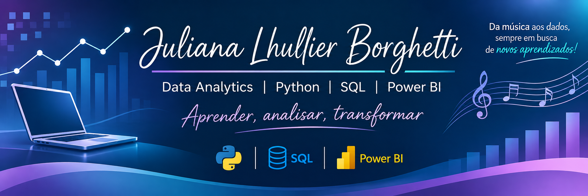

  

<h1 align="center">Olá! Eu sou Juliana 👋</h1>

<h3 align="center">Data Analytics | Python | SQL | Power BI</h3>

  Em transição de carreira para a área de Análise de Dados,
  unindo pensamento analítico, criatividade e experiência em educação.

---

### 💻 Sobre mim

- 📊 Estudante de Análise de Dados no SENAI/SC
- 🐍 Aprendendo Python e desenvolvendo projetos práticos
- 📚 Explorando SQL, visualização e análise de dados
- 🎓 Mestre em Música e Educação Musical pela UDESC
- 🚀 Construindo meu portfólio e evoluindo na área de dados

### 🛠️ Tecnologias em desenvolvimento

  

  
  
  
  

## 📊 Minhas estatísticas no GitHub

  
  

### 📂 Projetos

Em breve, meus projetos de análise de dados estarão disponíveis aqui!

---

  <i>Aprender, investigar, analisar e transformar dados em conhecimento.</i>

